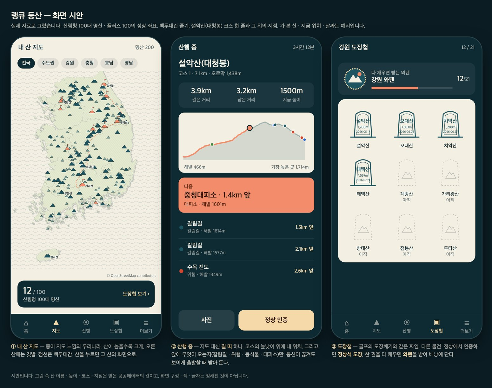
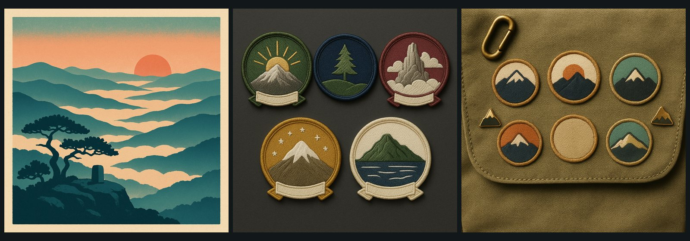

# 등산 — 세 번째 종목 (진행 기획)

> 2026-10-13 개정 · 오너:
> "gps 추적을 통해 트래킹 체크 및 사진을 업로드할 수 있고 … 골프 라운딩 중 사진 넣는 그런 느낌. 트래킹 중에 api로 동식물도 알려 주고 갈림길도 알려 주고 등등 모든 데이터를 망라한 등산 플랫폼인데 **너무 복잡하지 않게** 구성해야 되고, 지금 골프의 도장깨기가 너무 잘 되어 있어서 비슷하게 접목해 주고, 우리나라 지도를 일러스트 감성으로 등산객들이 좋아할 만한 느낌으로" → "진행 기획하자"
>
> 아직 만든 것은 없다. 11장을 오너가 정하면 9장의 순서대로 짓는다. 그림 두 장은 시안이다(②는 실제 자료로 그렸다).

## 1. 한 줄로

**산을 고른다 → 걷는 동안 길이 알려 준다 → 정상에서 도장을 받는다.** 자료는 다 쓰되 화면은 이 세 가지만 한다.

## 2. 오너의 말 → 기획

| 오너의 말 | 기획에서 |
|---|---|
| GPS 추적으로 트래킹 체크 | **산행 기록** — 걸은 길 · 거리 · 오른 높이 · 시간, 그리고 정상 인증(6장) |
| 사진 업로드(골프 라운드 사진 느낌) | **산행 사진** — 걷다가 찍으면 길 위의 그 자리에 붙는다. 골프 라운드 사진의 규칙(EXIF 제거 · 신고 · 차단)을 그대로 |
| 동식물 · 갈림길을 알려 준다 | **'다음' 카드** — 앞에 오는 갈림길 · 위험 구간 · 동식물 · 문화자원 · 대피소(5장) |
| 모든 데이터를 망라하되 복잡하지 않게 | 탭은 넷, 산행 중 화면은 하나(**길 띠**). 자료는 필요한 순간에만 나온다(4 · 5장) |
| 골프의 도장깨기를 접목 | 정상 도장 · 와펜 · 배낭 · 핀 · 산악회 도장(7장) |
| 우리나라 지도를 일러스트 감성으로 | **내 산 지도** — 종이 지도 위에 산 그림과 깃발(8장) |
| 섞이지 않게(10/12) | 자기 홈 · 색 · 탭 · 주소(`/hiking/…`) · 표. 골프의 볼마커 · 당구 배지를 쓰지 않는다 |

## 3. 가진 자료 — 직접 열어 확인한 것

| 자료 | 양 | 확인한 것 |
|---|---|---|
| **코스 선**(GPX) | 6,748개 · 봉우리 4,491곳 | 점마다 높이가 있다. 길이 중앙값 5.1km · 오르막 중앙값 563m. 오너가 받은 폴더(`~/Downloads/한국등산트레킹지원센터_전국 주요 봉우리 코스_20221116`, 526MB) |
| **길 위의 지점** | 50,243개 · 봉우리 4,247곳 | 갈림길 40,894 · 문화자원 3,854 · 위험 3,789 · 동식물 1,585 · 대피소 121. **전부 코스 선과 같은 번호로 이어진다**. 코스 선에서 중앙 5m(표본 803개 가운데 800개가 50m 안) — 걷는 사람 앞에 무엇이 오는지 계산할 수 있다 |
| 산 목록 | 16,565곳 · 명산 307곳 | 정상 좌표가 코스 선에서 중앙 5m — 정상 인증의 기준점으로 쓸 수 있다 |
| 산 소개 글 | 361곳 | 산림청 100대 명산 100곳은 공식 설명 기반(선정 이유 · 들머리 · 코스 경유지와 소요 시간 246개). **사람이 읽고 확인한 글은 아니다** |
| 산림청 100대 명산 플러스 | 100곳 | 공식 목록(좌표 · 높이 포함) — 두 번째 도장첩 묶음이 된다 |
| 국가숲길 지점 | 2,598개 · 숲길 5곳 | 쉼터 · 화장실 · 전망 · 안내판까지 있다(둘레길 쪽) |
| 승인된 API | 8종 + 신청 1종 | 산정보(3,368개 산 설명) · 명산등산로 · 100대명산 플러스 · 백두대간 종주 코스 · 국가숲길 POI · 문화자원 · 위험지역 · 야생동식물 POI / 산사태 예측(신청 중) |

알아 둘 것:

- **명산과 코스가 아직 다 이어지지 않았다.** 이름과 거리로 다시 이으면 산림청 100 가운데 60곳(코스 103개), 명산 307 가운데 209곳이다. 한라산 · 북한산 · 속리산 · 무등산 같은 큰 산은 이 묶음에 그 이름으로 없다 → **'산림청 100대명산' 코스 파일**(data.go.kr/data/15098177)과 명산등산로 API로 채운다. 맥의 폴더 이름은 풀어쓴 한글이라 잇는 스크립트가 글자를 맞춰 줘야 한다(이 점검에서 한 번 0건이 나왔다).
- **이용 조건**: 전국 주요 봉우리 코스 · 산림청 100대명산 · 산정보 서비스 세 곳은 포털에 '이용허락범위 제한 없음 · 무료'로 적혀 있다(2026-10-13 직접 확인). 지점 서비스들은 같은 기관이지만 페이지마다 한 번씩 봐야 한다. 조건과 무관하게 출처(산림청 · 한국등산트레킹지원센터)는 화면에 적는다.
- **지점 자료의 깊이**: 동식물 1,585개 가운데 설명이 있는 것은 368개이고 내용은 '야생화/담배풀' · '멧돼지 흔적' 정도다. 도감이 아니라 **'이 길에서 만나는 것'** 으로 쓴다. 위험 · 대피소 유형에는 **국가지점번호**가 섞여 있다 — 구조를 부를 때 쓰는 번호라 따로 꺼내 쓴다('지금 가장 가까운 국가지점번호').
- **오래된 자료**: 산림청 원문의 교통편 · 식당 · 전화번호는 싣지 않는다. 코스 소요 시간은 출처와 함께 적는다. 코스 선은 2022년 기록이다.
- 높이가 출처마다 20m 넘게 다른 명산 38곳 — 산림청 값을 쓴다.

## 4. 화면 — 탭 넷

| 탭 | 무엇 | 비고 |
|---|---|---|
| **홈** | 오늘 갈 만한 산(가까운 명산 · 날씨) · 내 진행(도장 n/100) · 이어서 하기 | 등산의 새벽 능선 색 |
| **지도** | 내 산 지도 — 우리나라 위에 명산과 내 깃발 | 산을 누르면 산 화면 |
| **산행** | 산행 시작 · 산행 중(길 띠) · 지난 산행 | 한 번에 한 산행 |
| **도장첩** | 권역 도장첩 · 배낭(와펜 · 핀) | 골프 도장첩의 짜임 |

**산 화면**(공개 페이지 `/hiking/mountains/<산>`)은 탭이 아니라 어디서든 들어가는 곳이다: 높이 · 위치 · 소개 · 코스들(길이 · 오르막 · 높낮이 그림) · 길 위의 지점 요약 · 날씨 · 이 산의 도장. 로그인 없이 열리고 검색에 걸린다.

## 5. 산행 중 — '길 띠' 하나

지도 앱을 만들지 않는다. 코스를 **한 줄의 띠**로 펴고 그 위에 내 위치와 앞에 오는 것만 보여 준다(시안 ② 가운데).

1. **출발 전**: 산 → 코스 고르기(길이 · 오르막 · 예상 시간) → '산행 시작'. 이때 코스 선과 지점을 기기에 받아 둔다 — 산에서는 통신이 끊긴다.
2. **걷는 중**: 높낮이 그림 위의 내 위치 · 걸은 거리 · 남은 거리 · 지금 높이. 그 아래 **'다음' 카드 한 장**(가장 가까운 것)과 그 뒤 서너 개.
   - 갈림길 100m 앞 · 위험 구간 앞에서는 진동과 한마디(앱에 읽어 주기 기능이 이미 있다). 동식물 · 문화자원은 조용히 카드로만.
   - 코스 선에서 멀어지면(예: 80m) '길에서 벗어났어요' 한 줄.
   - **사진** 단추 — 찍으면 길 위의 그 자리에 붙는다.
3. **정상**: 정상 가까이(권고 100m — 좌표가 코스 위에 정확히 있어 300m까지 넓힐 필요가 없다)에 오면 '정상 인증'이 켜진다 → 도장.
4. **끝**: 요약(거리 · 시간 · 오른 높이 · 지나온 지점 · 사진) → 저장. 공유는 본인이 고를 때만.

처음에는 실제 지도(지형도)를 깔지 않는다 — 길 띠와 코스 모양의 선 그림으로 충분한지 써 보고, 필요하면 뒤에 얹는다(9장 6단계).

## 6. GPS — 두 걸음으로

지금 앱(1.3)은 **앱이 켜져 있을 때만** 위치를 받는다. 안드로이드는 화면이 꺼진 동안의 위치 권한을 일부러 빼 두었다. 그래서 길이 둘이다.

| | A. 켤 때마다 확인 | B. 계속 기록 |
|---|---|---|
| 무엇 | 화면을 켤 때마다 위치를 잡아 길 띠에 찍는다. 정상 인증 · 사진 · '다음' 카드는 다 된다 | 화면이 꺼져도 걸은 길을 끝까지 기록한다 |
| 걸은 길 | 띄엄띄엄(화면을 켠 자리들) | 온전한 선 |
| 필요한 것 | **지금 앱 그대로** | **새 앱 빌드(1.4)** — 기기 쪽 위치 기록 기능 추가, 스토어 심사(위치를 왜 계속 쓰는지 설명과 화면 녹화), 배터리 시험 |
| 알림 | 화면이 켜져 있을 때만 | 주머니 속에서도 갈림길 앞에서 진동 |

- 권고: **A로 먼저 연다**(산 화면 · 길 띠 · 인증 · 도장첩이 빨리 나온다). **B는 1.4 빌드에 묶어** '기록 켜기'로 더한다. 오너가 말한 'GPS 추적'의 완성형은 B다.
- **골프와 다른 점 — 좌표를 저장한다.** 골프의 현장 인증은 좌표를 버리고 '인증됨'만 남겼다. 걸은 길은 좌표 그 자체라 위치정보법의 신고 · 약관 · 동의 · 보관과 파기 규정을 갖춰야 한다(10장). 기록은 기본 비공개, 내려받기와 지우기를 본인이 할 수 있게 하고, 공유할 때는 출발 · 도착 부근을 가릴 수 있게 한다.

## 7. 모으는 것 — 골프에서 옮겨 오는 것

| 골프 | 등산 | 다른 점 |
|---|---|---|
| 잉크 도장(골프장) | **정상 도장**(정상석 모양 · 산 이름 · 높이 · 날짜) | 코드로 그린다 |
| 권역 도장첩 아홉 권 | **권역 도장첩** — 산림청 100대 명산(강원 21 · 경남 15 · 수도권 14 · 경북 14 · 충청 13 · 전북 12 · 전남 10 · 제주 1) + 100대명산 플러스 | 공식 목록 둘로 200곳 |
| 볼마커 | **와펜**(자수 패치) | 한 권을 다 채우면 |
| 장식장 | **배낭** | 못 받은 자리는 박음질 윤곽 |
| 금테(코스 전부) · 사철 | **다른 코스로 다시** · **다른 철에 다시** | 코스 선이 있어 '어느 코스로 올랐는가'를 안다 |
| 업적 핀 | 핀 — 첫 산 · 10 · 50 · 100번째 산 · 1,000m 이상 · 네 철 · 대피소에 들른 산행 … | **빨리 · 야간 · 새벽 · 악천후로 받는 것은 넣지 않는다**(산에서는 사고를 부른다) |
| 시즌 태그 | 그해의 산행 리본(그해 오른 산 수) | |
| 크루 도장 · 깃발 | **산악회 도장** — 같은 산행에 회원 둘 이상 | 크루의 종목 값에 등산을 더한다 |
| 완성 공유 카드 | **산행 카드** — 코스 선 · 높낮이 · 사진 한 장 | 걸은 길이 그림이 된다 |

타수 같은 성적이 없으니 등급 · 순위는 만들지 않는다.

## 8. 지도 — 일러스트 감성

- **내 산 지도**(시안 ② 왼쪽): 종이 지도 위에 산 그림. 높은 산일수록 크게, 오른 산에는 깃발, 점선은 백두대간. 산의 자리는 좌표로 코드가 놓고(틀리면 안 된다), 종이 질감 · 파도 · 나침반 같은 장식만 그림으로 얹는다.
- 권역을 누르면 그 권역이 커지고 산 이름이 보인다. 다 오른 권역은 색이 찬다.
- **윤곽선은 새로 뽑는다.** 골프 지도의 윤곽선은 출처 기록이 없어 화면에만 쓰고 있다. 등산은 출처가 분명한 행정 경계(통계청 SGIS)에서 뽑아 공유 카드에도 쓴다. **울릉도 · 독도를 반드시 넣는다**(시안에는 빠져 있다).
- 산 화면의 코스 그림: 코스 선을 단순한 선으로, 그 아래 높낮이. 지점은 색 점으로.

## 9. 만드는 순서

| 단계 | 무엇 | 필요한 것 |
|---|---|---|
| 0 | **자료 적재** — 산 원장(명산 307 + 코스 있는 산) · 코스 선(점을 줄여 저장) · 길 위의 지점. 명산과 코스 잇기 보강 | 산림청 100대명산 코스 파일을 받아 큰 산을 채운다 |
| 1 | **공개 산 화면** — `/hiking`(허브) · 산 화면 · 코스 · 날씨 · 내 산 지도(방문자용) · 검색용 화면 · 사이트맵 | 종목 스위치는 아직 건드리지 않는다 |
| 2 | **등산 종목 열기**(시험 계정) — 홈 · 탭 · 색. 도장첩 · 배낭 | 와펜 · 표지 그림 제작 |
| 3 | **산행(A 방식)** — 코스 받아 두기 · 길 띠 · '다음' 카드 · 정상 인증 · 사진 · 요약 | 위치정보 신고 · 약관(10장) |
| 4 | **계속 기록(B 방식)** · 산행 카드 · 코스 이탈 알림 | 앱 1.4 빌드 · 스토어 심사 |
| 5 | 산악회 도장 · 국가숲길과 백두대간 종주(구간 도장) | |
| 6 | 실제 지도 · 산사태 예측 · 입산 통제 안내 | 산사태 API 승인 뒤 |

0 · 1단계는 지금 가진 것으로 바로 된다. 당구 · 골프 화면은 2단계 전까지 한 줄도 달라지지 않는다.

## 10. 조심할 것

- **위치정보법**: 걸은 길을 저장하면 위치기반서비스사업 신고와 위치정보 이용약관 · 동의가 필요하다. 골프의 현장 인증도 같은 숙제였다(오너 확인 대기). 3단계 전에 끝나야 한다.
- **안전**: 길 안내가 틀리면 사고가 난다. 코스 선은 2022년 기록이고 폐쇄 · 통제를 모른다 — 화면에 "참고용이며 현장 안내를 따르세요"를 적고, 입산 통제 기간(산불 조심 기간 · 국립공원 탐방로 통제)을 산 화면에 알린다. 재촉하는 알림을 보내지 않는다.
- **글**: 소개 글 361편은 기계 검사만 거쳤다. 산림청 100곳부터 표본을 읽고 낸다.
- **상표**: 코스 파일은 다른 등산 앱으로 기록된 것이다(파일 머리에 적혀 있다) — 출처는 제공 기관으로 적고 그 앱의 이름 · 모양을 쓰지 않는다. 다른 회사의 인증 프로그램 이름(명산100)을 도장첩 이름으로 쓰지 않는다.
- **출처 표시**: 산 좌표는 오픈스트리트맵(화면에 표시), 코스 · 지점 · 설명은 산림청 · 한국등산트레킹지원센터.
- **배터리 · 통신**: B 방식은 대여섯 시간 산행에서 배터리를 재 봐야 한다. 통신이 끊긴 동안의 인증 · 사진은 기기에 담아 두었다가 내려와서 보낸다.

## 11. 오너가 정할 것

| | 무엇 | 권고 |
|---|---|---|
| ① | GPS를 두 걸음으로 갈지 | **A(지금 앱)로 먼저 열고 B(1.4 빌드)를 잇는다.** B까지 기다렸다가 한 번에 열 수도 있다 |
| ② | 위치정보 신고 · 약관 | 걸은 길을 저장하려면 꼭 필요 — **오너가 확인** |
| ③ | 처음 여는 산의 범위 | **명산 200곳**(산림청 100 + 플러스 100)의 산 화면부터. 코스가 있는 산 3,500여 곳은 그 뒤 |
| ④ | 산행 중 화면 | **길 띠만**으로 시작. 실제 지도는 써 보고 정한다 |
| ⑤ | 탭 이름 | 홈 · 지도 · 산행 · 도장첩 |
| ⑥ | 더 받을 자료 | **산림청 100대명산 코스 파일**(15098177) — 큰 산의 코스가 여기 있다. 받은 폴더는 콘텐츠 작업 폴더(`_content/data/mountains/gpx/`)로 옮겨 두면 그쪽 정리와 이어진다 |

"추천대로"라고 하시면 0단계(자료 적재)부터 순서대로 짓는다.

## 12. 이번에 확인하며 만든 것

- 시안 ②는 실제 자료로 그렸다: 산림청 100 · 플러스 100의 정상 좌표, 백두대간 줄기, 설악산(대청봉) 코스 한 줄(7.1km · 오르막 1,438m)과 그 위의 지점 일곱 개. 가 본 산 · 지금 위치 · 날짜는 예시다.
- 시안 ①은 화풍을 보는 그림이다(표지 · 와펜 · 배낭). 원본은 `reports/hiking-1013/`(저장소 밖).
- 저장소와 DB에는 아직 등산의 코드 · 표가 없다.

## 13. 지은 것 — 10/13

오너: "이미지 제작 많이 해서 도장이나 이런 거 뿌듯하게 … 네비게이션은 크루와 채팅은 들어가야 돼 … 산은 각 지역으로 묶어도 되고 특성으로 묶고 다양한 스탬프를 받을 수 있게", 이어서 "100대 명산은 와펜이나 이미지 제작 … 등산도 등급을 줘서 … 많이 산을 정복할수록 등급이 높아지게".

### 13-1. 공개 화면(089a2e1e)
산 3,836곳 · 코스 5,434개 · 길 위의 지점 41,881개를 올리고 허브 · 권역 여덟 · 목록 · 산 화면과 검색용 화면 · 사이트맵을 냈다.

### 13-2. 세 번째 종목 · 도장 · 등급
- **종목**: 등산은 당구 · 골프와 나란한 세 번째 종목이다. 하단 탭은 **홈 · 산 · 도장첩 · 크루 · 채팅**. 지금은 운영자와 시험 계정에게만 열려 있다(`HIKING_PUBLIC` · `HIKING_TESTER_IDS`). 공개 산 화면은 누구나 본다.
- **정상 인증**: 산 화면에서 누르면 서버가 정상까지의 거리를 재고 150m 안이면 도장을 찍는다. **좌표는 저장하지 않는다**(인증 여부와 거리 구간만). 인증 없이 '다녀왔어요'로 적으면 흐린 도장(칸은 차지 않는다).
- **도장첩 25권**: 산림청 100대 명산(권역 여덟) · 명산 플러스(권역 여덟) · 특성(국립공원 · 하늘 가까운 산 · 높은 산 50 · 섬 · 도립공원) · **철 따라 가는 산(철쭉·진달래 26 · 단풍 27 · 억새 19 · 눈꽃 9)**. 한 산이 여러 권에 든다.
- **철 묶음을 만든 법**: 숫자로 판정되지 않아, 100대 명산의 소개 글에 그 말이 나오는 산만 넣었다(`shared/hikingFeatures`). 화면도 "소개 글에 억새가 나오는 산림청 100대 명산"이라고 적는다 — 우리가 순위를 매긴 것이 아니다. `/hiking/lists/maple` 처럼 공개 목록도 된다. 홈 · 허브에는 **'지금은 단풍 · 억새 철'** 구역이 그 달에만 뜬다.
- **산행 등급 여덟**: 정상에서 인증한 **서로 다른 산의 수**로 오른다 — 들머리 0 · 숲길 1 · 계곡 3 · 능선 7 · 암릉 15 · 정상 30 · 운해 60 · 하늘금 100. 같은 산을 여러 번 올라도 한 곳이다. 휘장은 산봉우리를 닮은 삼각 자수 패치(당구의 메달 · 방패, 골프의 볼마커와 다른 물건). 오른 날과 '몇 번째로 오른 회원인지'를 남긴다.
- **산 와펜 100장**: 100대 명산 한 곳마다 한 장. 그림은 그 산의 사진이 아니라 **소개 글의 소재(억새 · 암릉 · 계곡 …)와 높이로 그린 휘장**이고, 화면에 그렇게 적는다. 아치 모양과 테두리 실(권역의 색)은 화면이 그려 백 장이 한 벌이다. 산 화면의 표지 · 목록의 앞머리 · 배낭에 놓인다.
- **배낭**: 산행 등급 사다리 · 산 와펜(권역별) · 도장첩 와펜(배낭 덮개) · 핀 여덟.
- **그림**: 도장첩 와펜 27 · 핀 8 · 등급 휘장 8 · 산 와펜 100 · 표지 22(허브 · 권역 · 목록). 글자 · 숫자 · 상표 · 사람 없음.
- **받는 것에 없는 것**: 빨리 · 야간 · 새벽 · 악천후(사고를 부른다).
- **검색**: `/hiking/stamps`(도장첩) · `/hiking/pack`(산행 등급 · 와펜)도 검색용 화면과 사이트맵에 들어갔다.

### 13-3. 내가 정한 것 — 다르게 하고 싶으시면 말씀만
1. 등급의 이름(산을 오르며 지나는 자리)과 문턱(1 · 3 · 7 · 15 · 30 · 60 · 100).
2. 등급은 **아무 산이나** 센다(명산이 아니어도 정상을 아는 산이면). 100대 명산만 세면 처음 오르는 사람의 동네 산이 빠진다.
3. 철 묶음은 어느 철에 올라도 칸이 찬다(제철에 오르면 다른 도장을 주는 것은 다음에).
4. 산 와펜은 100대 명산만(플러스 100곳은 그림이 없다 — 반응을 보고 늘린다).

### 13-4. 산행 중 '길 띠'(A 걸음)
- 산 화면의 코스 아래 **'이 코스로 산행 시작'** → `/hiking/trail/<산>`. 한 화면에 셋: 길 띠(높낮이 위 내 자리 · 지나온 만큼 산호빛) · 정상까지(거리 · 남은 오르막 · 어림한 시간) · **다음**(갈림길 · 위험 구간 · 대피소 — 앞으로 몇 m, 오르막 몇 m). 가까운 국가지점번호가 있으면 구조 요청용으로 보여 준다.
- 정상 150m 안에 오면 그 자리에서 정상 인증을 권한다(도장 · 산 와펜 · 등급이 그 자리에서 뜬다).
- 마치면 걸은 시간 · 길 위의 거리 · 오른 높이를 남긴다(표 `hiking_trips`). **걸은 길 · 좌표는 저장하지 않는다** — 위치는 기기 안에서만 쓴다. 5분이 안 되는 산행은 남기지 않는다. 홈에 '최근 산행'.
- 화면을 켜 둔 동안만 위치를 본다(6초마다 한 번). 켜 둔 동안 화면이 꺼지지 않고, 하단 탭 · 앱 설치 안내가 덮지 않는다. 화면을 떠났다 돌아와도 이어서 쌓는다(기기에 적어 둔다 — 좌표 없음).
- **한계를 적어 둔다**: 코스 선은 2022년 기록을 160점으로 줄인 것이라 '길을 벗어났다'는 경보는 내지 않는다. 이 코스에서 250m 넘게 떨어졌을 때만 "코스가 맞는지 확인해 주세요". 안내는 참고용이라고 화면에 적는다.
- 남은 것: 사진(산행 중 올리기 — 신고 · 차단 · 사진 정보 지우기까지 한 벌로) · 음성 안내 · 더 촘촘한 코스 선(벗어남 알림) · 화면이 꺼져도 이어지는 기록(B 걸음, 새 앱 빌드 + 위치정보 신고).

### 13-5. 읽을거리 — 용어 사전 · 준비물
- `/hiking/terms`(등산 용어 사전 40가지 — 길과 지형 · 산행 방식 · 장비와 옷 · 안전과 제도)와 말마다의 화면 `/hiking/terms/<말>`("들머리 뜻"처럼 묻는 검색에 한 화면으로 답한다), `/hiking/checklist`(준비물 — 언제나 · 있으면 편한 것 · 사철, 누르면 지워지고 기기에만 남는다).
- 싣는 기준: 산에서 실제로 쓰는 말과 랭큐 화면에 나오는 말. 틀리기 쉬운 숫자 · 날짜(통제 기간 · 예약 구간)는 적지 않고 "가기 전에 확인". 상표 · 술 · 빨리/밤 산행을 부추기는 말은 싣지 않는다(`shared/hikingTerms`).
- 검색용 화면 · 사이트맵 · 봇 경로에 넣었고, 허브에 '산행 길잡이' 두 장이 생겼다.

### 13-6. 등산 알림함 · 산행 사진 · 같은 이름의 산
- **등산 알림함**: 산악회의 알림(정모 · 가입 · 채팅)은 등산 알림함에만 뜬다. 등산 홈의 머리줄에 종이 생겼다. 당구 알림함에는 섞이지 않는다.
- **산행 사진 — 첫 걸음은 내 사진첩**: 산 화면과 산행 중 화면에서 올린다. 올린 사람에게만 목록이 보인다. 사진의 위치 정보는 올릴 때 지우고(화면이 다시 그리고 서버가 한 번 더 걷는다), 어디서 찍었는지는 저장하지 않는다. 하루 40장 · 산마다 120장까지.
  남에게 보이는 자리(산의 공개 사진 · 산악회 사진첩)는 신고 · 차단 · 가리기를 한 벌로 갖춘 뒤에 연다 — 골프 라운드 사진을 연 방식이다.
- **같은 이름의 산**: 100대 명산의 지리산 둘 · 백운산 셋은 한 화면에 같이 놓일 때 시군을 붙인다("지리산(통영)").

### 13-7. 코스 없는 명산 잇기 · 등산으로 시작하기 · 산악회가 함께 오른 산
- **코스 잇기**: 받은 코스 묶음은 봉우리마다 묶여 있어 100대 명산 40곳에 제 이름의 코스가 없었다. 이웃 봉우리의 코스 가운데 **그 산의 정상 150m 안을 지나는 것**(35km 아래)을 옮기지 않고 이어서 보여 준다(`hiking_course_links` · `server/scripts/hiking-link-courses.ts`). 명산 27곳에 코스 46개가 이어졌고(금정산 5 · 회문산 5 …), 100대 명산 가운데 코스가 없는 산은 40 → 28곳이 됐다. 화면은 "장군봉 쪽에서 이 산의 정상을 지나는 길이에요"라고 적는다. 남은 28곳(한라산 · 북한산 · 속리산 · 무등산 …)은 산림청 100대명산 코스 파일이 있어야 한다.
- **등산으로 시작하기**: 설정의 주 종목에 등산 칸(등산을 쓸 수 있는 회원에게만 — 서버가 확인한다). 앱을 열면 등산 홈에서 시작한다.
- **함께 오른 산**: 산악회 홈에, 같은 날 두 사람 이상이 정상에서 인증한 산이 산악회의 도장으로 남는다. 누가 올랐는지는 싣지 않는다(산 · 처음 함께 오른 날 · 횟수). 혼자 오른 산은 그 사람의 도장이다.

### 13-8. 공유 카드 · 음성 안내
- **공유 · 검색 카드 12장**: 등산 화면이 당구의 공용 그림을 달고 나가던 것을 등산의 카드로(허브 · 도장첩/배낭 · 용어 사전 · 준비물 · 권역 여덟). 산 한 곳 · 목록은 허브 카드.
- **음성 안내**(산행 중 화면의 스위치 — 기본은 끔): 가까운 갈림길 · 위험 구간 · 대피소가 300m · 80m 안에 들어올 때 한 번씩, 정상이 500m 남았을 때와 정상에서, 코스에서 멀어졌을 때 말로 알린다. 같은 말을 되풀이하지 않고, 꺼 둔 동안 지난 지점을 켜는 순간 몰아 읽지 않는다. 앱에서는 기기의 음성 엔진을 쓴다.
- 접속 배너는 산악회 동료를 넣지 않고(당구 '한 판'을 권하게 된다), 당구 도전 신청은 산악회에서 막는다.

### 13-9. 받아 둔 코스 파일을 끝까지 쓰기
- 받은 코스 묶음 4,492개 가운데 917개는 어느 산에도 이어지지 않아 싣지 않았었다(묶음의 이름이 '용문봉' · '추월산보리암' · '사량도지리산'처럼 봉우리라서). 그 가운데 **코스가 없는 명산의 정상 150m 안을 지나는 묶음 24개**를 그 명산의 코스로 실었다(적재 스크립트의 셋째 규칙).
- 그 뒤 코스 잇기를 다시 돌렸다. 지금: 코스 5,473개 · 지점 42,363개 · 명산 307곳 가운데 248곳에 코스 · **100대 명산은 80곳**(처음 60 → 이어서 72 → 80).
- 남은 100대 명산 20곳: 한라산 · 화악산 · 가야산 · 점봉산 · 두타산 · 대암산 · 명지산 · 무등산 · 주흘산 · 속리산 · 희양산 · 성인봉 · 대야산 · 백운산(정선) · 북한산 · 내연산 · 변산 · 덕숭산 · 미륵산 · 깃대봉. 받아 둔 파일에는 이 산들의 정상을 지나는 길이 없다 — `한국등산트레킹지원센터_산림청 100대명산_20220112`(data.go.kr/data/15098177) 파일이 있어야 한다.
